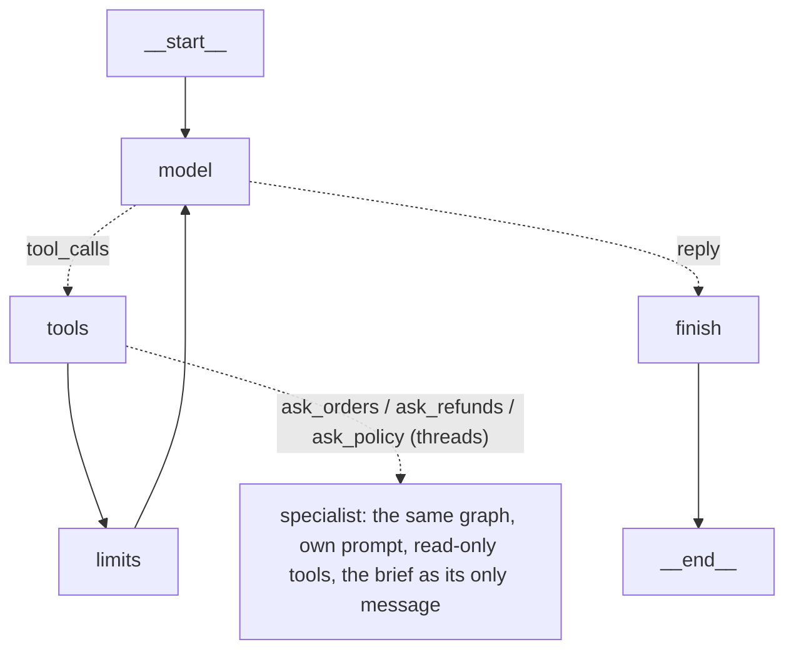

# Stage 8: Multi-agent (rung 4)

Sweeps on 2026-10-29 (UTC), through the unchanged harness, on `gpt-6-luna` for every agent:
- capability v1, 30 tasks × 3: the supervisor (`supervisor`) and handoffs (`handoffs`), against Stage 6's single agent `graph_all` at k5, paired on its first 3 trials;
- the new parallel set, 8 tasks × 5: `graph_all` and `supervisor`.

Spend was **$0.155** of the planned $5:

| Run | Trials | Spend |
|---|---|---|
| Smoke (supervisor and handoffs on c02, c09, c12) and calibration (`graph_all` and `supervisor` on the parallel set, 8 × 1) | 22 | $0.0180 |
| Re-checks (handoffs after the fix, `graph_all` on the reworded p06, `supervisor` on p01 with Langfuse) | 5 | $0.0034 |
| `graph_all` parallel 8 × 5 | 40 | $0.0192 |
| `supervisor` parallel 8 × 5 | 40 | $0.0472 |
| `supervisor` v1 30 × 3 | 90 | $0.0417 |
| `handoffs` v1 30 × 3 | 90 | $0.0254 |

To regenerate the tables:

```
arl report --regrade results/20261029T001125Z-graph_all-gpt-6-luna-k5.json \
  results/20261029T181640Z-supervisor-gpt-6-luna-k3.json \
  results/20261029T183248Z-handoffs-gpt-6-luna-k3.json
arl report --regrade results/20261029T180017Z-graph_all-gpt-6-luna-k5.json \
  results/20261029T180551Z-supervisor-gpt-6-luna-k5.json
```

They are saved as `results/report-phase8-v1.md` and `results/report-phase8-parallel.md`.

## The concepts

| Term | Here |
|---|---|
| Orchestrator-workers (supervisor) | One agent owns the ticket; some of its tools are other agents. It writes a brief, a subagent works in a fresh context, and only the subagent's final report comes back as the tool result. The supervisor replies to the customer |
| Handoffs | Peers take turns owning one shared conversation. A transfer tool changes who is active; the next peer sees everything said so far, under its own prompt and tools, and may reply itself |
| Isolated context | A subagent sees its prompt and the brief only: not the ticket, the other subagents or earlier answers |
| Shared context | Every peer sees the whole conversation: the ticket, every earlier call, result and reasoning item |
| Token multiplier | Σ over tasks of the arm's mean tokens per run ÷ the same sum for the single agent, on the same tasks and the first min(k) trials. A run's tokens are input (cached included) + output, over every model call of every agent |
| Single writer | Only one agent holds the write tools. Here: the supervisor; in handoffs, the `actions` peer |

### Isolated vs shared: what each buys and loses

| | Buys | Loses |
|---|---|---|
| Isolated (supervisor) | Small, focused contexts; a subagent cannot be steered by text it never sees; work can be split and run at the same time | Whatever the brief leaves out. The same order is often read by two agents. The policy and tool definitions are sent again in every agent's prompt |
| Shared (handoffs) | Nothing is lost between agents | Every call resends the whole history under the active peer's prompt; each handoff is an extra turn; a peer reads its predecessors' turns as if they were its own (see the handoff bug below) |

### Why multi-agent costs more tokens

Each agent resends its own system prompt and tools; briefs and reports are text written once and read again; the supervisor makes an extra call to combine the reports; isolated agents repeat lookups. Measured here: 1.56× the tokens and 2.45× the dollars on v1.

### Why only one agent should write

Two writers acting on different partial views make conflicting changes (a refund here, an escalation there, or the same refund twice). One writer means every change is decided by the agent that saw all the reports, and the gate, the idempotency keys and the audit have one place to live. It is enforced in code: an agent asking for a tool it was not given gets `tool_not_available`, whatever the model was bound to.

### Where multi-agent fails, and when it helps

The MAST categories are the specification lost in a brief, agents disagreeing or repeating work, the orchestrator trusting a wrong report, and missing verification. All but the last showed up here (see "How it failed"). Multi-agent helps on breadth-first work whose pieces are independent and together would crowd one context (Google/MIT: +81% on parallelisable tasks), and hurts on sequential work (−39% to −70%). Our tickets are short and sequential, and even the bulk audits fit easily in one context.

## How it is built



**The supervisor is the graph agent whose tools include agents.** `graph_agent.py` gained opt-in fields on `AgentContext` (`agent`, `tools`, `system`, `delegates`, `run_delegates`); with the defaults it is the Stage 6/7 graph exactly. The supervisor is `compiled_graph()` with a supervisor context: the four writes, escalation, three specialists, and no lookup tools, so it must delegate. A specialist is the same compiled graph again, run from inside the supervisor's `tools` node with its own context. Because the supervisor *is* the gated graph, the Stage 7 approval gate works on it unchanged (tested).

| Path | Contents |
|---|---|
| `framework/graph_agent.py` | `AgentContext` fields for multi-agent; `Delegated` (what a subagent or handoff did); in `tools`: the `toolset` guard, `act_after_reports` (no write in the same turn as a question to a specialist), and a pre-pass that gates and runs a batch's delegated calls, then merges them in call order |
| `framework/multi/specialists.py` | Agent specs: orders (5 reads), refunds (assessor: get_order, get_shipment), policy (no tools); the supervisor's role; `MULTI_GUARDS` (graph_all's guardrails with a 60,000-token run pool) |
| `framework/multi/supervisor.py` | Delegation: limits, the pool split, store copies, threads, buffered traces merged in order |
| `framework/multi/handoffs.py` | `HandoffState` (`active`, `handoffs`); peers triage → orders → actions; transfer tools; one graph whose nodes are graph_agent's own, run as the active peer (`runtime.override(context=...)`) |
| `tracing/tracer.py` | An optional `agent` on every event (`as_agent`); `BufferedTracer` for a thread; `merge` renumbers model calls |
| `evals/runner.py`, `report.py`, `cli.py` | Strategies `supervisor`, `handoffs`; a per-trial `agents` record; the supervisor's worst case; report sections for multipliers, per-agent shares and coordination; `PHASE = "phase-8"` |
| `evals/tasks.py`, `tasks/parallel/` | The parallel set, frozen (`FROZEN_PARALLEL_HASH = 2cc7a9b329ed`) |

| Lines of code (no docstrings or comments) | |
|---|---|
| `graph_agent.py` | 449 (371 at Stage 7: +78 for the hooks) |
| `multi/supervisor.py` | 170 |
| `multi/handoffs.py` | 157, about 30 of them prompt text |
| `multi/specialists.py` | 101, about 50 of them prompt text |

### Guardrail state and budgets across agents

| | Rule |
|---|---|
| Taint | Run-level. A specialist's taint is OR-ed into the supervisor's state, so a note read by `orders` blocks the supervisor's later write. Handoffs share one state |
| Grounding | A specialist's successful reads ground order ids for the supervisor from its **next** step. An id seen only in a report's text grounds nothing |
| Loop detection | Per agent context. Two agents reading the same order is a *repeated lookup* (measured), not a loop |
| Step caps | Supervisor 10 of its own calls; each specialist 5; at most 8 specialist runs per ticket; handoffs share one cap of 10 and at most 3 transfers |
| Budget | One pool per run for all agents: 60,000 tokens (3× the single agent's), $0.01, 120 s. Specialists running at the same time get equal shares of what is left |
| Recursion limit | Per graph invoke; a specialist's config sets its own |
| Worst case (runner) | The pool plus what can still run after it trips: per specialist, the crossing call, a reply-only call and a truncation retry; then the supervisor's reply and retry. $0.088 per trial |

### Threads, the store and the trace

Specialists asked in one turn run at the same time in langchain_core's `ContextThreadPoolExecutor`, which copies contextvars into each thread, so LangChain callbacks and Langfuse spans stay nested. The trial's SQLite connection belongs to the main thread, so each specialist reads its own copy (SQLite's backup API), taken just before it starts. The copy is exact because specialists only read and `act_after_reports` forbids a write in a turn that asks a specialist. The fault injector is shared behind a lock.

Each specialist logs into a buffered tracer; afterwards the main thread appends the buffers in call order and renumbers model calls on from the run's count. The file's order and numbering do not depend on which thread finished first (tested over 20 jittered runs), and `Transcript` turns stay correct, so the graders read a multi-agent trace unchanged: a specialist's `get_shipment` in turn 2 comes before the supervisor's `issue_refund` in turn 4.

A specialist's config names its own thread id, so the installed LangGraph (1.2.14) runs it as a fresh root graph rather than a subgraph: it never writes into the parent's checkpoints or inherits its drain, while callbacks are still inherited. Checked live: the Langfuse trace is `supervisor → tools → agent:orders → model / tools / limits / finish`, one trace per run.

### Idempotency keys and checkpoints

Keys stay `run id : model call id`, and only the writer writes, so keys come from the writer's call ids, stored in its messages. Delegation counts and call offsets are read from state; nothing is numbered in a closure. Specialist runs are not checkpointed: a resumed supervisor `tools` step would run its read-only specialists again (paid twice, harmless).

## Options and what we chose

| Decision | Options | Chosen | Why |
|---|---|---|---|
| Single writer | a writer subagent; the supervisor | The supervisor (handoffs: `actions`) | The agent that has read every report decides every change |
| Approval | gate on; graph_all's guardrails only | No gate in the sweeps; one scripted test with the gate | The comparison isolates the architecture; on v1 the gate asked on 3.3 tickets per 100 and changed nothing graded |
| Concurrency | one after another; threads | **Threads** (your choice), with a store copy per specialist and buffered traces | Real latency. The sequential path (`max_workers=1`) is the same code |
| Budget | per agent; one pool at 20k; one pool at 60k | One pool, 60,000 tokens (your choice) | A 6-item audit should not be cut off by the multiplier itself. Largest run seen: 27,315 |
| What a specialist sees | brief only; brief + ticket | Brief only (your choice) | Pure isolation; the cost of what a brief drops is part of what we measure |
| Parallel set | read-only; mixed; extend the seed | 5 read + 3 audit-and-act on the unchanged seed (your choice) | No `env/` change |
| Prompts | role only; the policy in every agent | The full policy + defence + a role section, in every agent | Identical rules everywhere; the shared prefix caches (87–93% cached) |
| Handoffs | agents as subgraph nodes with `Command.PARENT`; a state key | One graph, `active` in the state, graph_agent's nodes run as the active peer | LangChain's documented "tool updates `active_agent`, routing reads it" form, with no new node code |

## How it is tested

83 new tests; 698 pass and 2 are skipped, with no API calls. The `graph_off` / `graph_all` parity, the 26 twins, approval, crash and checkpoint tests pass unchanged, and a test checks that the default context offers all ten tools and the Stage 7 prompt.

- **Supervisor** (`test_supervisor.py`, 29; both providers through `tests/wire.py`, each agent answering from its own script, routed by the role line in its prompt): c09 end to end, graded; isolation (a specialist sees the brief, not the ticket, and only its reads); a specialist cannot write; `act_after_reports`; taint and grounding across agents; the pool tripping inside a specialist; no specialist once the pool is spent; the pool split; the delegation cap; specialists provably overlapping (a barrier); the trace identical across 20 jittered runs; a specialist reading the supervisor's earlier write; a specialist's API failure making an error trial with its trace kept; the key from the supervisor's call id; the supervisor through the risk-tiered gate.
- **Handoffs** (`test_handoffs.py`, 13): c09 through triage and actions, graded; the next peer sees the whole conversation and the transfer's answer; per-peer tools; only `actions` writes; one handoff per turn; the handoff cap; taint across peers; the runner's per-peer counts.
- **Parallel set** (`test_parallel_set.py`, 37): every reference passes the real graders, with and without invariants; consistency; no environment change; a size check (a single agent doing the reference stays under 75% of its token budget: 5–11k); the frozen hashes of all three sets.
- **Runner** (4): the supervisor sweep and its `agents` record; the worst case bounded by the pool; the runner estimates without importing LangGraph; the CLI knows the strategies and the set.

### The parallel set

Eight bulk audits on the unchanged seed. A ticket names several orders; each needs its own lookups and judgement, and the answer combines them.

| Task | Items | Graded by |
|---|---|---|
| p01 late orders and their value | 6 | the sum (524.00), the late ids, the on-time ids not listed |
| p02 orders inside the return window | 6 | the sum (536.99), ids, the outside ids not listed |
| p03 orders that can still be cancelled | 6 | the sum (551.50), ids, the others not listed |
| p04 carrier and tracking for six orders | 6 | the six tracking numbers |
| p05 status of every order, from an email | 3 | the dates |
| p06 two damage claims (one out of window) and a status | 3 | db (one refund, one escalation) and facts |
| p07 refund one damaged unit, return a sealed item, and a status | 3 | db (refund and return) and facts |
| p08 returns from two orders, one not delivered | 2 | db (one return) and facts |

Calibrated for validity, not difficulty, on `graph_all` 8 × 1 (7/8). One rewrite round: the money facts of p03, p06 and p07 now accept "$22" as well as "22.00" (p06's only failure), and p06 says "both notebook packs" (the item is a 2-pack, quantity 2, so "the two notebooks" could mean $11 or $22; the supervisor smoke chose $11, the single agent $22). Then frozen.

## What we measured

Code-graded only. The judge is unvalidated (Stage 4).

### Capability v1 (30 tasks × 3; the single agent at k5, paired on its first 3 trials)

| Arm | Success | pass^3 | Write | Refuse | Escalate | Calls/run | Tokens/run | $/run | p50 / p95 |
|---|---|---|---|---|---|---|---|---|---|
| `graph_all` (single agent) | 98% | (pass^5 93%) | 100% | 90% | 100% | 2.90 | 6,707 | $0.000187 | 4.6 / 8.7 s |
| `supervisor` | 88% | 80% | 81% | 67% | 100% | 5.23 | 10,607 | $0.000464 | 11.0 / 19.0 s |
| `handoffs` | 98% | 97% | 100% | 100% | 89% | 3.69 | 7,781 | $0.000282 | 6.6 / 10.8 s |

| Against the single agent (v1) | Tokens | Cost | Model calls | Uncached input | p50 latency |
|---|---|---|---|---|---|
| `supervisor` | **1.56×** | **2.45×** | 1.78× | 2.73× | 2.36× |
| `handoffs` | **1.15×** | **1.49×** | 1.26× | 2.16× | 1.42× |

Where it went: the supervisor's own calls took 56% of its tokens (48% of the dollars), `orders` 33%, `refunds` 11%, `policy` 1% (asked on 4% of tickets). In handoffs, `actions` took 69%, `triage` 15%, `orders` 16%; 1.01 handoffs per run.

### The parallel set (8 tasks × 5)

| Arm | Success | pass^5 | Calls/run | Tokens/run | $/run | p50 / p95 |
|---|---|---|---|---|---|---|
| `graph_all` (single agent) | 92% | 75% | 2.83 | 8,324 | $0.000479 | 6.9 / 15.6 s |
| `supervisor` | 85% | 75% | 6.38 | 15,090 | $0.001179 | 15.4 / 25.1 s |

| Supervisor against the single agent | Tokens | Cost | Model calls | p50 latency | Success |
|---|---|---|---|---|---|
| all 8 tasks | 1.81× | 2.46× | 2.26× | 2.24× | 85% vs 92% |
| p01–p04 (6-item audits) | 1.98× | 2.67× | 2.30× | 12.9 vs 5.9 s | 100% vs 95% |
| p05–p08 (2–3 items, with writes) | 1.72× | 2.34× | 2.23× | 19.9 vs 10.0 s | 70% vs 90% |

Paired by task: the single agent better on p06 (3/5 vs 2/5) and p08 (5/5 vs 2/5), the supervisor better on p02 (5/5 vs 4/5), 5 ties; p = 1.0.

### Findings (cost, tokens, calls and latency are measured precisely)

1. **Multi-agent cost more on every ticket set, in every unit.** The supervisor cost 2.45× (v1) and 2.46× (parallel) per run, with 1.56× and 1.81× the tokens and 1.78× and 2.26× the model calls. Handoffs cost 1.49× with 1.15× the tokens.
2. **Dollars grew faster than tokens** (2.45× against 1.56× on v1), because more of the input missed the cache: 91.6% of the supervisor arm's input was cached against 95.5% for the single agent, so uncached input grew 2.73×. Each new agent context is a fresh conversation whose first call shares only the policy prefix with what came before.
3. **It was slower, even with real parallelism.** p50 latency 2.36× on v1 and 2.24× on the parallel set. The threads did overlap: on the parallel set, turns that asked several specialists took 149 s of wall time for 287 s of specialist time. But the supervisor needs at least three sequential model steps (ask, specialists, reply) where the single agent needs two, and its specialists make two calls each.
4. **On the 6-item audits the supervisor almost never split the work.** In 19 of 20 runs of p01–p04 it sent one brief to `orders` covering all six orders, and `orders` did what the single agent does: one batch of parallel tool calls. Only one run fanned out (p03, six specialists). The tool layer already gives the single agent parallelism for this kind of work, so a second layer of agents added only cost.
5. **Isolation repeated work where the supervisor did split.** On p06–p08 it asked 2–3 specialists and paid 2–4 repeated lookups per run (`orders` and `refunds` reading the same orders).
6. **No unsafe action, double write or runaway in any arm.** The single writer, the pooled budget and the guards held: largest run 27,315 tokens of the 60,000 pool; no limit tripped.

### Directions (success differences, not findings)

- **Supervisor vs single agent, v1:** worse on 6 tasks, better on 1, 23 ties; p = 0.125. A finding needs 6 tasks, all one way. Write 81% (vs 100%) and refuse 67% (vs 90%).
- **Supervisor vs single agent, parallel set:** 85% vs 92%, p = 1.0. The hypothesis stated before the runs (the supervisor gains on p01–p04) is not supported: 100% vs 95% there, one trial apart, at 2.67× the cost.
- **Handoffs vs single agent, v1:** 98% vs 98%, one task each way. Both of its c18 failures are a phrase-list false negative: the reply "No return has been authorized yet" contains the forbidden phrase "return has been authorized". The behaviour (refuse and escalate) was right. The grader is left unchanged; read with it, handoffs would be 100% on c18.

### How it failed (every failed multi-agent trial, read)

| Failure | Where | Trials | MAST category |
|---|---|---|---|
| **A doubt raised in the brief comes back as a blocker.** The supervisor asks the refunds specialist to establish whether damaged goods were opened; the specialist, who cannot see the customer, reports it as unknown; the supervisor then asks the customer or escalates instead of refunding goods that arrived damaged | c09 (+1 in the smoke run), c11, p06 | 2 + 3 (p06: 0 refunds in the 3 runs whose report raised it, 2 refunds in the 2 that did not) | the orchestrator trusting a report; the specification lost in the brief |
| **Refuse, then escalate as well** | c15, c16, c21 | 5 | disagreement between policy and action (the single agent did it on c22 only) |
| **A fact lost on the way to the reply.** The action was right, but the delivery date lived in a specialist's report and the reply never gave it | c23 | 3 of 3 | information withheld between agents (the same failure as the Phase 6 workflow on c23) |
| **A brief that drops the customer's words.** "Two things that are still sealed" was cut down to the headphones; the specialist looked for two headphones in an order of one, and the supervisor escalated | p08 | 3 | the specification lost in the brief |

The single agent's failures in the same sets were judgement on single tickets (c22; one wrong window on p02; an extra escalation of a late order on p06).

**A handoff bug, found in the smoke run and fixed before the sweeps.** After a transfer, the new peer read the previous peer's transfer call as its own last turn. Twice it replied with empty text; once the `actions` agent told the customer it had "passed the request to our actions team", that is, to itself (0/3 in the smoke run). The fix is in how a handoff is announced, not in v1 answers: the transfer's result now tells the new peer that the ticket is its own and to reply to the customer, and each peer's role says that earlier assistant turns may be other agents'. After the fix, 3/3 and then 98% on v1. Shared context has a cost that isolation does not: every peer inherits the others' turns as if it had written them. OpenAI accepted histories holding another peer's tool calls for tools not bound in the current request (its docs say nothing either way).

## Did multi-agent earn its cost here?

**No.** On v1 the supervisor cost 2.45× per ticket, was 2.4× slower and succeeded less often (88% against 98%, a direction). Handoffs matched the single agent's success at 1.49× the cost and 1.4× the latency: no gain to pay for. On the parallel set, built to give multi-agent its fair chance, the supervisor cost 2.46× and was 2.2× slower for no measurable gain in success, and on the audits it was designed for it mostly handed the whole job to one specialist, which did what the single agent does.

The reasons are in the measurements. Every ticket fits easily in one context (the single agent's largest run was 12k tokens on v1 and 21k on the audits; tool results are 300–700 tokens per audit). Parallel tool calls already give one agent the parallelism. And our tickets are sequential decisions on a few facts, where every brief and report is a place to lose one: the four failure patterns above are all about information crossing between agents.

## When you would choose differently in production

- **Use a supervisor when a single context would really be crowded:** many independent pieces each needing a lot of reading (long documents, search results, logs), where a subagent compresses its share into a short report. Our tool results were too small for that to pay.
- **Prefer parallel tool calls in one agent before parallel agents.** They gave the same concurrency here at about 40% of the cost.
- **Keep a single writer, and enforce it in code**, not only by which tools are bound. Here a specialist asking for `issue_refund` gets `tool_not_available`.
- **Write briefs as structured data, not prose.** Copy the customer's own words verbatim and pass the facts the reply must state (dates, amounts) back in structured fields. Three of the four failure patterns are a brief or a report dropping or inventing something.
- **Don't let a specialist report "unknown" for something only the customer can know.** Tell the orchestrator what each specialist can and cannot establish, or let the specialist say "not determinable from the record" without turning it into a blocker.
- **For handoffs, tell the new agent it is now in charge.** Handoffs were the cheaper pattern and matched the single agent once the transfer said so; they suit routing between real specialisations (different tools, different policies), not this one-policy desk.
- **Budget multi-agent runs as a pool, and split it between concurrent agents.** A per-agent budget would let N agents spend N times the limit.
- **Run concurrent subagents on their own read connections** (or a thread-safe store) and keep one writer on the main one; merge their traces in a fixed order so the audit trail does not depend on timing.

## Limits

- One model for every agent (gpt-6-luna). A stronger orchestrator or a different split of roles could do better; nothing was tuned on the test sets.
- v1 at k3 against a k5 reference paired on its first 3 trials; the parallel set has 8 tasks, so only cost, tokens, calls and latency are findings.
- The parallel set was calibrated on the single agent, and its p06 wording was fixed after the supervisor's smoke run exposed the ambiguity (the single agent had also hit the $11/$22 question). It was not tuned to make either arm fail.
- The prompts (supervisor role, specialist roles, peer roles) were written once, plus the handoff fix. Different role wording could change the failure patterns above.
- The handoffs arm was not run on the parallel set (as planned).
- The judge was not used. The handoffs c18 failures are a known phrase-list false negative.
- One calibration run stalled for about 1h45m while the Mac slept (lid closed); its latencies for that run are not used. The sweeps ran with the Mac awake.
- `results/*.json` record a `-dirty` git commit, because the Phase 8 code was uncommitted when the sweeps ran.
